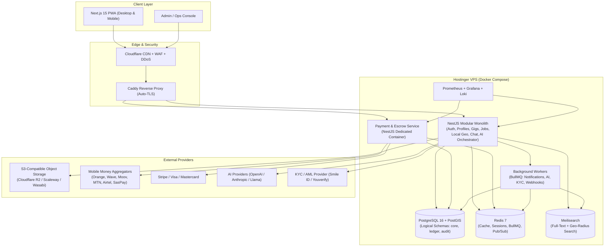
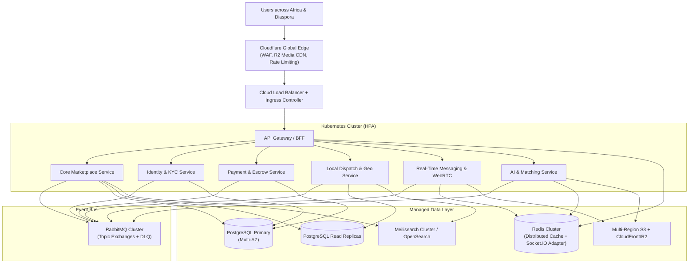
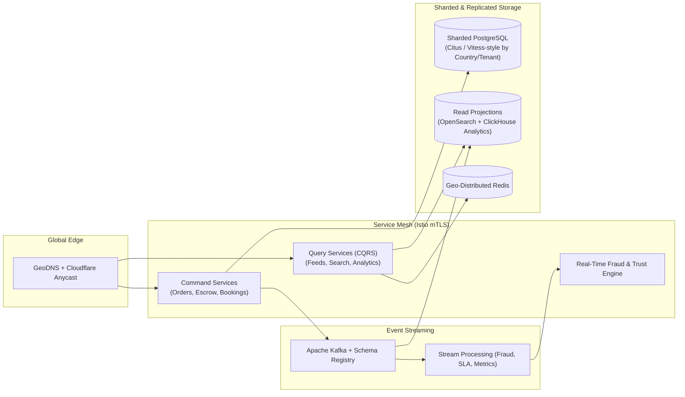

# 1. System Architecture

## Architectural Principles for African Markets
1. **Low-Bandwidth Resilience**: Next.js PWA with Workbox offline caching, WebP/AVIF adaptive media, and lightweight JSON payloads for 3G/4G mobile networks.
2. **Financial Isolation from Day 1**: Even in Phase 1, the **Payment & Escrow Service** runs as a separate process/container with its own database schema and strict idempotency guarantees.
3. **Evolutionary Topology**: Avoid premature distributed-systems tax at 0–50K users while keeping strict interface boundaries (REST/gRPC + Outbox events) for seamless extraction at 50K+ and 1M+ users.

---

## Phase 1: Launch & Growth (0 – 50,000 Users)
**Topology**: Single-node or dual-node Hostinger VPS running Docker Compose behind Caddy/Traefik TLS reverse proxy, fronted by Cloudflare CDN/WAF.

### Phase 1 Trade-offs
- **Modular Monolith vs. Full Microservices**: Eliminates network hops, distributed tracing complexity, and DevOps overhead while a small team ships MVP features. *Trade-off*: Single deployment unit for core domain; mitigated by strict NestJS module boundaries and separate Payment container.
- **Meilisearch vs. Elasticsearch**: Meilisearch uses ~10x less RAM than Elasticsearch on a VPS while delivering sub-50ms typo-tolerant and geo-filtered search.

---

## Phase 2: Scale-Up (50,000 – 1,000,000 Users)
**Topology**: Managed Kubernetes (EKS / GKE / AKS in `eu-west` + `af-south-1` Cape Town) with Horizontal Pod Autoscaling (HPA), RabbitMQ event bus, managed PostgreSQL with read replicas, and Redis Cluster.

---

## Phase 3: Pan-African Hyperscale (1,000,000+ Users)
**Topology**: Multi-region active-active deployment (`af-south-1`, `eu-west-1`, `eu-south-1` / local edge PoPs), Istio Service Mesh (mTLS, circuit breaking, canary routing), Apache Kafka event streaming, and CQRS with sharded PostgreSQL.

