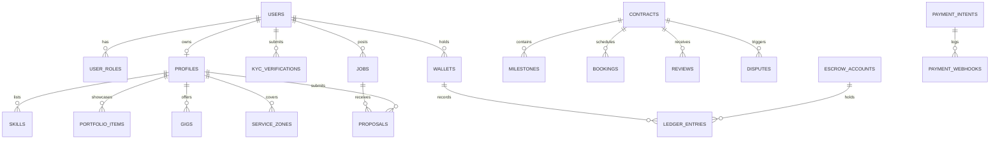

# 2. Database Architecture

## Design Philosophy
- **PostgreSQL 16 + PostGIS** is the single source of truth for relational, geospatial, and financial data.
- **Logical Schema Isolation** in Phase 1 (`identity`, `marketplace`, `local_services`, `ledger`, `comms`, `audit`) enables zero-rewrite extraction into separate databases in Phase 2/3.
- **Double-Entry Accounting** for all financial movements: no balance column is ever mutated without an immutable `ledger_entries` pair (debit + credit).

---

## Core Entity-Relationship Diagram (ERD)

---

## Key Domain Schemas & Tables

### 1. Identity & Multi-Country Tenant Context (`identity`)
- `users`: `id (UUIDv7)`, `email`, `phone_e164`, `password_hash`, `country_code (ISO-3166)`, `preferred_currency (ISO-4217)`, `preferred_locale`, `mfa_enabled`, `trust_score (0-100)`, `status`, `created_at`.
- `user_roles`: `user_id`, `role (CLIENT | FREELANCER | LOCAL_PROVIDER | AGENCY | ENTERPRISE | ADMIN | MODERATOR | AUDITOR)`, `organization_id (nullable)`.
- `kyc_verifications`: `id`, `user_id`, `tier (TIER_0..TIER_3)`, `document_type`, `document_hash`, `provider_ref`, `aml_status`, `verified_at`, `expires_at`.
- `device_fingerprints`: `id`, `user_id`, `fingerprint_hash`, `ip_inet`, `geo_country`, `risk_score`, `last_seen_at`.

### 2. Marketplace & Geospatial (`marketplace` & `local_services`)
- `profiles`: `id`, `user_id`, `type (DIGITAL | LOCAL | HYBRID | AGENCY)`, `headline`, `bio`, `hourly_rate_minor`, `currency`, `availability_status`, `rating_avg`, `completed_count`, `is_featured`.
- `service_zones` (PostGIS): `id`, `profile_id`, `location (GEOGRAPHY(POINT, 4326))`, `radius_km`, `city`, `country_code`.
  - **Index**: `CREATE INDEX idx_service_zones_geo ON service_zones USING GIST (location);`
- `gigs`: `id`, `profile_id`, `category_id`, `title`, `slug`, `packages_jsonb (Basic/Standard/Premium)`, `delivery_days`, `is_sponsored`, `status`.
- `jobs`: `id`, `client_id`, `mode (FREELANCE_BID | LOCAL_DISPATCH)`, `title`, `description`, `budget_min_minor`, `budget_max_minor`, `currency`, `location (GEOGRAPHY(POINT, 4326) nullable)`, `scheduled_at`, `status`.
- `proposals`: `id`, `job_id`, `provider_id`, `amount_minor`, `currency`, `cover_letter`, `ai_match_score`, `status`.
- `contracts`: `id`, `client_id`, `provider_id`, `source_type (GIG | JOB | BOOKING)`, `source_id`, `total_amount_minor`, `platform_fee_minor`, `tax_minor`, `currency`, `status (ACTIVE | COMPLETED | DISPUTED | CANCELLED)`.
- `milestones` / `bookings`: milestone deliverables or local on-site time windows with OTP/QR check-in/check-out codes.

### 3. Double-Entry Financial Ledger (`ledger`)
- `wallets`: `id`, `owner_id`, `owner_type (USER | PLATFORM | TAX_RESERVE)`, `currency`, `available_balance_minor`, `pending_balance_minor`, `version (optimistic lock)`.
- `escrow_accounts`: `id`, `contract_id`, `currency`, `funded_minor`, `released_minor`, `refunded_minor`, `status`.
- `ledger_transactions`: `id`, `idempotency_key (UNIQUE)`, `type (FUND_ESCROW | RELEASE_MILESTONE | COMMISSION | PAYOUT | REFUND | CHARGEBACK)`, `reference_id`, `created_at`.
- `ledger_entries`: `id`, `transaction_id`, `account_id`, `direction (DEBIT | CREDIT)`, `amount_minor (BIGINT > 0)`, `currency`, `created_at`.
  - **Invariant**: For every `transaction_id` and `currency`, `SUM(DEBIT) == SUM(CREDIT)`.
- `payment_intents`: `id`, `user_id`, `provider (ORANGE_MONEY | WAVE | MOOV | MTN_MOMO | AIRTEL_MONEY | SASPAY | STRIPE)`, `amount_minor`, `currency`, `provider_tx_id`, `status`, `raw_response_encrypted`.

---

## Indexing, Partitioning & Scaling Strategy

| Phase | Strategy | Details |
|---|---|---|
| **Phase 1 (0–50K)** | Single PostgreSQL 16 + PostGIS | UUIDv7 primary keys (time-ordered, B-tree friendly). GIST indexes for local service radius queries. Partial indexes on `status = 'ACTIVE'`. |
| **Phase 2 (50K–1M)** | Read Replicas + Table Partitioning | Partition `ledger_entries`, `audit_logs`, `messages`, and `notifications` by month (`RANGE (created_at)`). Route search/analytics/profile reads to Read Replicas via PgBouncer. |
| **Phase 3 (1M+)** | Horizontal Sharding + CQRS | Shard `marketplace` & `local_services` by `country_code` / `region_id` (Citus or application-level shard router). Keep `ledger` strongly consistent per currency/country shard. Offload analytics to ClickHouse. |
