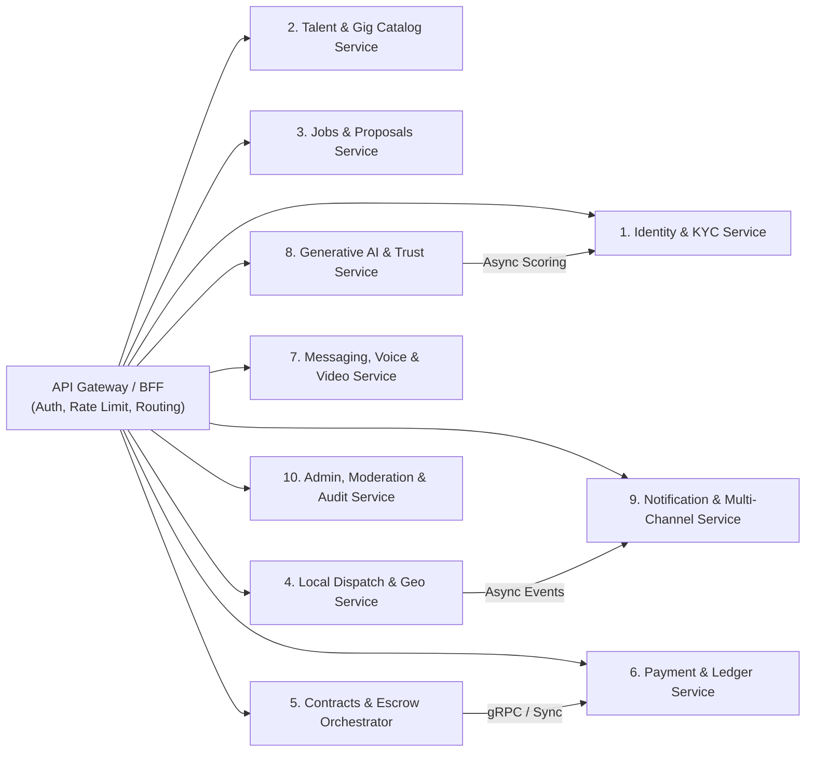

# 3. Microservices Architecture

## Evolutionary Service Decomposition

AFRIWORK follows the **Monolith-First with Isolated Financial Core** pattern:
- **Phase 1**: 2 deployable backend units — `core-monolith` (NestJS Modular Monolith) + `payment-service` (isolated NestJS microservice) + `worker` (BullMQ consumer).
- **Phase 2**: Extract high-throughput / distinct-scaling modules into independent Kubernetes deployments communicating via REST/gRPC (sync) and RabbitMQ (async).
- **Phase 3**: Full domain-aligned microservices behind an Istio Service Mesh with CQRS read projections.

---

## Service Map & Responsibilities

### Detailed Service Boundaries

| Service | Core Responsibility | Data Store | Scaling Profile |
|---|---|---|---|
| **1. Identity & KYC** | JWT/OAuth/MFA, RBAC, KYC tiering (Smile ID/Youverify), AML, device fingerprinting | PostgreSQL (`identity`), Redis | CPU-light, high read-rate (cached JWT/JWKS) |
| **2. Talent & Gig Catalog** | Profiles, portfolios, skills verification, Gig packages, sponsored listings | PostgreSQL (`marketplace`), Meilisearch, S3 | Read-heavy (90:10 read/write) |
| **3. Jobs & Proposals** | Job posting, bidding, proposal lifecycle, invite-to-apply | PostgreSQL (`marketplace`), Redis | Burst writes on popular jobs |
| **4. Local Dispatch & Geo** | PostGIS radius search, provider availability slots, booking windows, on-site OTP/QR check-in | PostgreSQL+PostGIS, Redis Geo | Latency-sensitive geo queries |
| **5. Contracts & Disputes** | Contract state machine, milestone approvals, dispute workflow, SLA timers | PostgreSQL (`marketplace`) | Strong consistency required |
| **6. Payment & Ledger** | Mobile Money (Orange, Wave, Moov, MTN, Airtel, SasPay), Stripe/Cards, double-entry escrow, split payouts, tax & commission | PostgreSQL (`ledger`), Redis locks | **Strict ACID**, isolated network & PCI scope |
| **7. Comms (Chat/Voice/Video)** | 1:1 & group chat, file sharing, voice notes, WebRTC video call signaling (LiveKit/Agora) | PostgreSQL (`comms`), Redis Pub/Sub, S3 | Stateful WebSockets, horizontal socket scaling |
| **8. Generative AI & Trust** | Job/Proposal/Contract generation, talent matching, fraud/collusion detection, trust scoring, pricing hints | Vector DB (`pgvector`), LLM APIs | High latency external I/O, async queues |
| **9. Notifications** | Push (FCM/APNs), SMS (Africa's Talking/Twilio), WhatsApp Business API, Email | Redis, Queue (BullMQ/RMQ) | High fan-out, retry-heavy |
| **10. Admin & Audit** | Moderation queues, financial audit exports, immutable audit log, feature flags | PostgreSQL (`audit`), ClickHouse (Ph3) | Internal/low QPS, strict RBAC |

---

## Inter-Service Communication Rules
1. **Synchronous (REST / gRPC)**: Used only for direct user-blocking queries (e.g., `Contracts -> Payment` to reserve escrow funds). Protected by timeouts (2–5s), retries with exponential backoff, and circuit breakers.
2. **Asynchronous (Domain Events)**: Used for all cross-domain side effects (e.g., `ContractCompleted -> UpdateTrustScore`, `TriggerInvoice`, `SendNotification`). Zero distributed two-phase commits (2PC); eventual consistency via Saga + Outbox pattern.

## Trade-offs
- **Why isolate Payment Service in Phase 1?** Mobile money webhooks are notoriously flaky and require strict idempotency, separate secrets, and PCI/regulatory auditability. Isolating it early prevents a bug in Profile/Chat from crashing or corrupting financial state.
- **Why keep Chat/Notifications inside the Monolith in Phase 1?** Saves container memory and simplifies local/VPS debugging until concurrent WebSocket connections exceed ~10,000.
