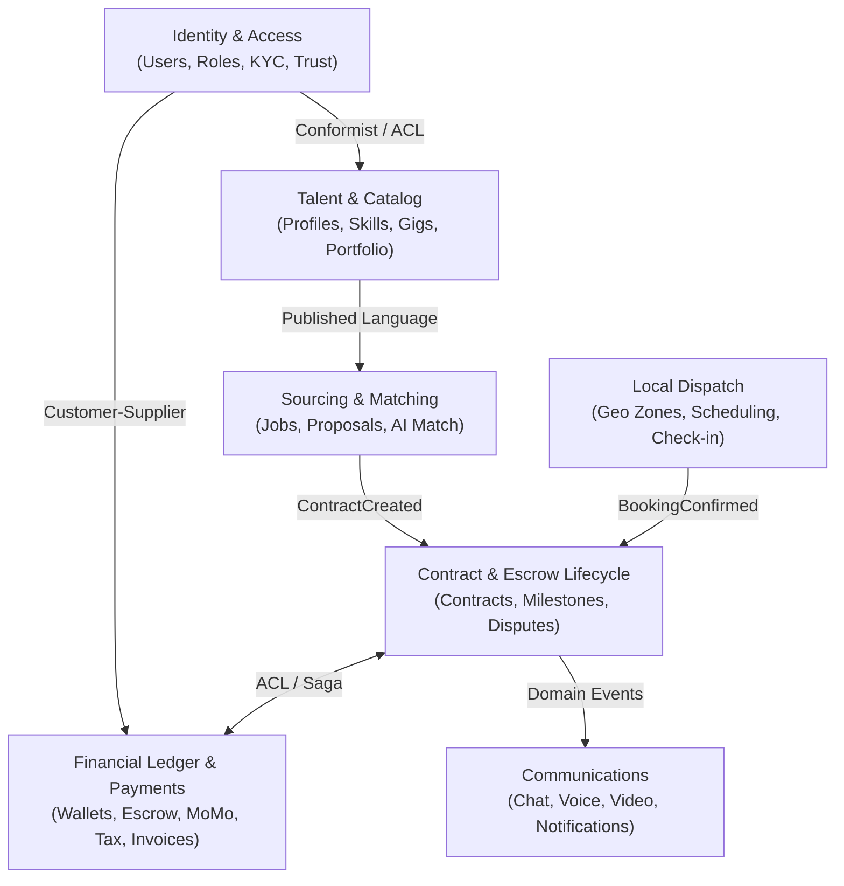

# 5. Domain-Driven Design (DDD)

## Strategic Design: Bounded Contexts & Context Map

---

## Tactical Design: Aggregates, Value Objects & Invariants

### 1. `Contract` Aggregate (Contracting Context)
- **Root Entity**: `Contract` (`id`, `clientId`, `providerId`, `type`, `status`, `currency`)
- **Child Entities**: `Milestone[]`, `Dispute`
- **Value Objects**: `Money(amountMinor: bigint, currency: CurrencyCode)`, `CommissionRate(bps: number)`
- **Key Invariants**:
  - A `Contract` cannot transition to `ACTIVE` until `EscrowFunded` is confirmed by the Financial Context.
  - Sum of `Milestone.amount` must equal `Contract.totalAmount`.
  - Only `CLIENT` can approve a milestone; if `DISPUTED`, funds are frozen until `MODERATOR` resolution.

### 2. `LedgerTransaction` & `Wallet` Aggregates (Financial Context)
- **Root Entity**: `Wallet` (`id`, `ownerId`, `currency`, `availableMinor`, `pendingMinor`, `version`)
- **Immutable Event-Sourced Entity**: `LedgerTransaction` containing `LedgerEntry[]`
- **Key Invariants**:
  - **Zero-Sum Rule**: `SUM(DEBIT) === SUM(CREDIT)` per transaction & currency.
  - **No Negative Available Balance**: Withdrawals/escrow locks fail atomically if `availableMinor < requestedMinor`.
  - **Automatic Split**: On milestone release, `LedgerTransaction` atomically splits `grossAmount` into:
    - `ProviderWallet` (+net)
    - `PlatformRevenueWallet` (+commission)
    - `TaxReserveWallet` (+withholding/VAT if applicable in country)

### 3. `LocalBooking` Aggregate (Local Dispatch Context)
- **Root Entity**: `LocalBooking`
- **Value Objects**: `GeoPoint(lat, lng)`, `TimeWindow(startUtc, endUtc)`, `VerificationPin(6-digit hash)`
- **Key Invariants**:
  - Provider cannot have overlapping `CONFIRMED` time windows.
  - On-site arrival and completion are cryptographically verified via client-provided OTP/QR scan to prevent ghost-job fraud.

---

## Ubiquitous Language Glossary
| Term | Definition |
|---|---|
| **Talent / Provider** | Either a Digital Freelancer, Local Service Provider, or Agency offering services. |
| **Gig** | A pre-packaged, fixed-scope service offering with Basic/Standard/Premium tiers. |
| **Job** | A client-posted requirement open for custom Proposals or direct Local Dispatch. |
| **Escrow** | Ring-fenced funds held in a platform custody ledger account until delivery is verified. |
| **Split Release** | Atomic distribution of escrow funds across Provider, Platform Fee, and Tax Reserve. |
| **Trust Score** | Dynamic 0–100 score combining KYC tier, completion rate, dispute ratio, and AI fraud signals. |
