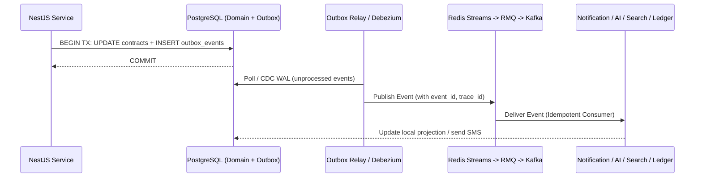

# 6. Event Architecture

## Core Pattern: Transactional Outbox
To guarantee **at-least-once delivery** without distributed 2PC transactions, every state change writes both the domain mutation and an `outbox_events` row in the **same PostgreSQL transaction**. A relay/poller publishes uncommitted events to the broker.



---

## Broker Evolution Across Phases

| Phase | Broker | Use Case |
|---|---|---|
| **Phase 1 (0–50K)** | **BullMQ (Redis Streams / Lists)** | Background jobs, webhook retries, email/SMS/push, Meilisearch indexing, AI async tasks. |
| **Phase 2 (50K–1M)** | **RabbitMQ Cluster** | Topic-based routing (`marketplace.contract.*`, `payment.escrow.*`), dead-letter exchanges (DLQ), priority queues for OTP/Payments. |
| **Phase 3 (1M+)** | **Apache Kafka + Schema Registry** | High-throughput event streaming, replayability, real-time Flink fraud detection, CQRS read-model projections, ClickHouse ingestion. |

---

## Canonical Event Envelope (CloudEvents-Compatible)
```json
{
  "specversion": "1.0",
  "id": "evt_01J9X8K2M4N5P6Q7R8S9T0",
  "source": "/services/payment-ledger",
  "type": "com.afriwork.payment.escrow.funded.v1",
  "time": "2026-11-24T03:00:00Z",
  "datacontenttype": "application/json",
  "subject": "contract:cnt_01J9X",
  "tenant_country": "SN",
  "data": {
    "contract_id": "cnt_01J9X",
    "amount_minor": 150000,
    "currency": "XOF",
    "provider": "WAVE"
  }
}
```

---

## Critical Saga: Escrow Funding & Milestone Release
1. Client initiates payment (`POST /payments/intents`) → `PaymentIntentCreated`.
2. Mobile Money provider calls webhook → `PaymentWebhookReceived` → `PaymentService` verifies HMAC & credits `EscrowAccount` → emits `EscrowFunded.v1`.
3. `ContractService` consumes `EscrowFunded.v1` → transitions contract to `ACTIVE` → emits `ContractActivated.v1`.
4. `NotificationService` sends Push + WhatsApp/SMS to Provider.
5. **Compensation (Failure Path)**: If `EscrowFundingFailed` or timeout occurs after 15 mins, `PaymentIntent` expires and `Contract` stays `DRAFT`.

## Dead Letter Queue (DLQ) & Poison Pill Handling
- Consumers retry with exponential backoff: `1s -> 5s -> 30s -> 5m -> 30m` (5 attempts).
- Failed messages move to `<queue>.dlq` with original payload + stack trace, triggering a Grafana/PagerDuty alert for ops replay.
