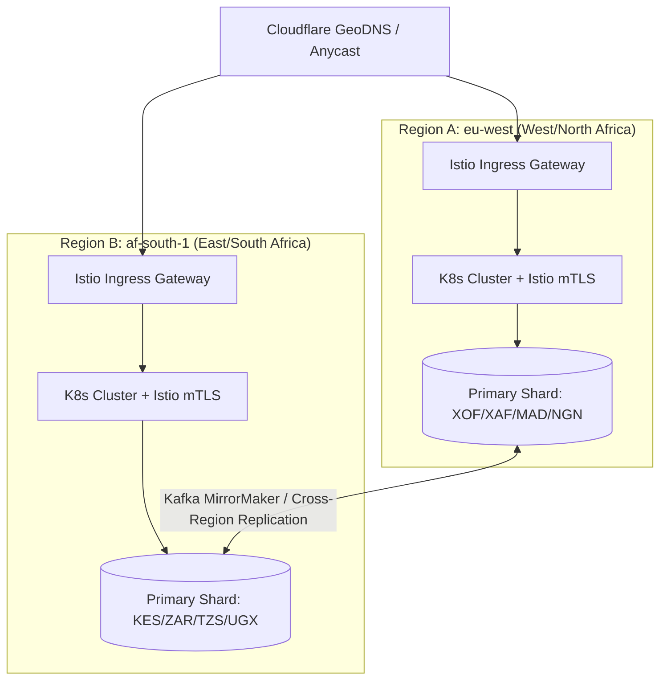

# 7. Infrastructure Architecture

## Cloud-Agnostic Portability Strategy
Everything runs in **OCI-compliant Docker containers** with **Terraform** (IaC) and **S3-compatible storage**. Moving from Hostinger VPS (Phase 1) to AWS/GCP/Azure (Phase 2/3) requires **zero application code changes**—only swapping Terraform provider modules and managed service endpoints.

---

## Phase 1: Hostinger VPS (0 – 50,000 Users)
- **Compute**: Hostinger KVM 8 (8 vCPU, 32 GB RAM, 400 GB NVMe) in Europe/Frankfurt or Paris (low latency to West/North Africa) + optional KVM 4 standby/worker node.
- **Networking**: Cloudflare DNS + WAF + CDN in front of VPS; Caddy v2 on VPS for automatic Let's Encrypt TLS & HTTP/3.
- **Runtime**: Docker Compose (`nextjs-pwa`, `nestjs-api`, `payment-service`, `bullmq-worker`, `postgres-postgis`, `redis`, `meilisearch`, `prometheus`, `grafana`, `loki`).
- **Backups**: Automated `pg_dump` + WAL archiving every 6 hours encrypted with `age`/GPG and pushed to Cloudflare R2 / Backblaze B2.

---

## Phase 2: Managed Kubernetes (50,000 – 1,000,000 Users)
- **Region Strategy**: Primary cluster in `eu-west-1` (Ireland/Paris) + `af-south-1` (AWS Cape Town) for Southern/Eastern Africa latency optimization.
- **Compute**: EKS / GKE with Karpenter/Cluster Autoscaler (Spot instances for AI/batch workers, On-Demand for API/Payment pods).
- **Data**: Managed PostgreSQL (RDS Multi-AZ / Cloud SQL) + ElastiCache Redis Cluster + RabbitMQ (Amazon MQ / CloudAMQP).
- **Edge**: Cloudflare Workers for geo-routing, static asset caching, and bot mitigation.

---

## Phase 3: Multi-Region Active-Active + Service Mesh (1,000,000+ Users)

### African Latency & Connectivity Optimizations
1. **Cloudflare PoPs**: Leverage African edge PoPs (Lagos, Nairobi, Johannesburg, Dakar, Abidjan, Cairo, Casablanca) for TLS termination and static/API-edge caching.
2. **Media Optimization**: Automatic resizing & WebP/AVIF transcoding at edge so portfolio/gig images load in <500ms on 3G.
3. **Resumable Uploads**: TUS protocol for portfolio videos and KYC documents on unstable mobile connections.
