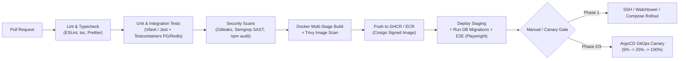

# 8. CI/CD Architecture

## Monorepo & Pipeline Strategy
- **Repository Structure**: Turborepo + pnpm workspaces (`apps/web`, `apps/api`, `apps/payment-service`, `packages/shared-types`, `packages/ui`).
- **Branching Model**: Trunk-based development (`main` + short-lived `feat/*` PRs + `release/*` tags).

---

## Database Migration Safety
1. **Expand-and-Contract Pattern**: Never run breaking `DROP COLUMN` or `ALTER TYPE` in the same release as code changes.
2. **Pre-Deploy Gate**: Migrations run as an init-container / CI pre-step (`prisma migrate deploy` or `typeorm migration:run`) with a lock timeout (`SET lock_timeout = '5s'`) so a slow lock never queues production traffic.
3. **Zero-Downtime Rollouts**:
   - **Phase 1**: Blue-green container swap behind Caddy (`docker compose up -d --no-deps --scale api=2` → healthcheck pass → drain old container).
   - **Phase 2/3**: Argo Rollouts with automated Prometheus error-rate/p99 rollback triggers.
