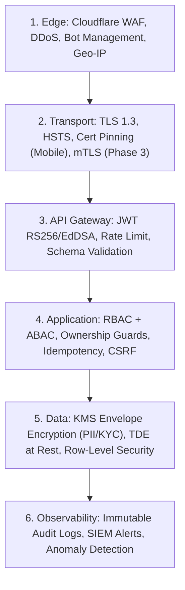

# 9. Security Architecture

## Defense-in-Depth Layers

---

## OWASP Top 10 & API Security Top 10 Controls
- **BOLA / IDOR (API1)**: Every resource endpoint enforces ownership/role predicates via NestJS Guards + PostgreSQL Row-Level Security (RLS).
- **Broken Authentication (API2)**: Argon2id password hashing, short-lived JWTs (15m), refresh token rotation with reuse detection (revokes entire token family on theft), mandatory MFA (TOTP / SMS-OTP) for withdrawals, Admins, and Auditors.
- **Injection & SSRF**: Parameterized queries only, strict Zod/class-validator DTOs, outbound webhook/avatar URL allowlisting.
- **Webhook Spoofing**: Constant-time HMAC-SHA256 verification + provider IP allowlisting + replay timestamp window (<5 mins).

---

## KYC, AML & Fraud Architecture
- **Tiered KYC (Risk-Based Onboarding)**:
  - `TIER_0`: Phone + Email verified (Browse, post jobs, low-value gigs <\$50).
  - `TIER_1`: National ID / Passport + Liveness Selfie via Smile ID / Youverify (Unlock Mobile Money withdrawals up to country limit).
  - `TIER_2`: Proof of Address + Tax ID / Business Registration (Agencies, Enterprises, unlimited payouts).
- **AML & Sanctions Screening**: Automated PEP/OFAC/UN/EU sanctions screening at KYC and on payouts >\$1,000 equivalent.
- **Device Fingerprinting & Velocity Rules**: FingerprintJS + IP ASN/VPN detection flags multi-account collusion (e.g., client and freelancer sharing the same device/MoMo number to farm referrals or launder funds).
- **AI Fraud Scoring**: Real-time scoring of off-platform circumvention attempts (phone/WhatsApp sharing in pre-contract chat), abnormal chargeback spikes, and fake review rings.

---

## Immutable Audit Logs, Backups & Disaster Recovery
- **Audit Logs**: Append-only `audit.events` table (no `UPDATE`/`DELETE` permissions for app role) + shipped to WORM S3 bucket (Object Lock). Captures `actor_id`, `role`, `ip`, `device_id`, `action`, `before_hash`, `after_hash`, `timestamp`.
- **Encryption**: TLS 1.3 in transit; AES-256 at rest; Envelope Encryption (AWS KMS / HashiCorp Vault) for National IDs, bank/MoMo tokens, and tax numbers.
- **Disaster Recovery Targets**:
  - **Phase 1**: RPO ≤ 15 mins (WAL archiving), RTO ≤ 2 hours.
  - **Phase 2/3**: RPO ≤ 1 min (sync/semi-sync Multi-AZ), RTO ≤ 15 mins (automated failover).
